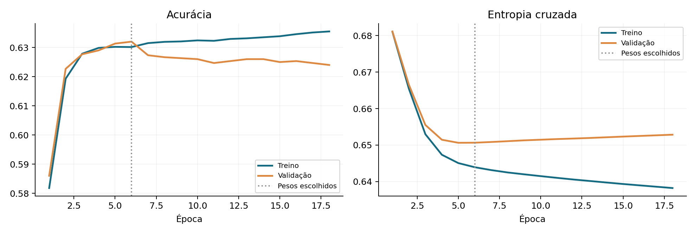
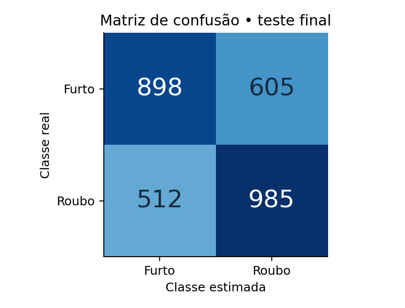

# Ocorrências SP — classificação com MLP

Global Solution · Aprendizado Profundo com Redes Neurais Convolucionais.

**Aluno:** Matheus Moura da Silva  
**RM:** 566782  
**Turma:** 2CCPR

Uma MLP classifica registros de ocorrências de São Paulo como **furto simples** ou **roubo**. O projeto compara três arquiteturas com dados reais, inclui notebook executado e uma aplicação que usa os pesos treinados. Não estima risco de ocorrência de crimes.

## Aplicação

Endereço hospedado: **https://ocorrencias-sp-mlp-lab.awakegerbil3.chatgpt.site/**

A aplicação está **pública, sem exigir login no ChatGPT**. Em 10/11/2026, foi aberta em um navegador que antes exibia a tela de login; após a liberação, a página e o modelo carregaram sem autenticação. O formulário foi testado com dois exemplos e validou o preenchimento obrigatório do distrito.

O GitHub armazena o código e os materiais; a aplicação acima já está hospedada separadamente. Nenhum repositório foi criado na conta do aluno. O envio do projeto ao GitHub e a entrega pelo portal da faculdade serão feitos pelo aluno. O workflow de GitHub Pages é uma alternativa opcional de hospedagem; não precisa ser ativado para usar o link público acima.

## Execução rápida

A aplicação já inclui o modelo treinado e pode ser executada **sem instalar bibliotecas de aprendizado de máquina**:

```bash
python SERVIR_APP.py
```

Abra **http://localhost:8000**. Não abra `dist/index.html` diretamente por `file://`, pois o navegador pode bloquear a leitura de `modelo.json`. O formulário recebe distrito do fato e mês de registro; exibe classe e percentuais. Não transmite os valores a um servidor de inferência.

## Reproduzir os experimentos

Python 3.12 é a versão de referência. Execute os comandos na raiz do projeto:

```bash
python -m venv .venv
# Linux/macOS
source .venv/bin/activate
# Windows PowerShell, em vez do comando acima:
# .venv\Scripts\Activate.ps1
python -m pip install -r requirements.txt
python treinar.py
python verificar.py
jupyter lab modelo_mlp_sp.ipynb
```

O notebook contém as definições completas de treinamento, saídas calculadas e gráficos. Executar todas as células recria os resultados e sobrescreve os artefatos, de maneira determinística dentro do mesmo ambiente. Pequenas diferenças podem ocorrer entre versões ou implementações numéricas. O notebook não depende de baixar novamente a fonte: utiliza a amostra minimizada incluída.

Para refazer também o download e a preparação dos microdados:

```bash
python preparar_dados.py
python treinar.py
python verificar.py
```

O download histórico tem aproximadamente 43 MB comprimidos e sua leitura exige memória adicional. Em caso de indisponibilidade da origem, use a amostra incluída, cuja procedência está documentada. Se o hash do arquivo remoto mudar, o script interrompe a preparação para exigir nova auditoria; não ignore essa divergência.

## Dados e procedência

- Fonte institucional de referência: https://www.ssp.sp.gov.br/estatistica/consultas
- Espelho histórico realmente utilizado: https://github.com/nublia/data-science-playground
- Arquivo baixado: https://raw.githubusercontent.com/nublia/data-science-playground/master/dat/boletins_ocorrencia_sp_clean_2016.csv.gz
- Dicionário / contexto do distribuidor: https://github.com/nublia/data-science-playground/blob/master/nb/boletins_ocorrencia.ipynb
- O distribuidor atribui os dados à SSP-SP, com distribuição via data.world; este projeto não realizou download direto do portal atual.
- Período: registros de **2016**, conforme `ANO`. A data de acesso foi **10/11/2026**.
- SHA-256 do arquivo original: `fcad92a9f348b59b9c7a5b195d1fb956f8fb75eb9a5e55f84665d0bb7c0de70d`.

O espelho possui 770.371 linhas. Excluímos 12.920 linhas associadas a BOs inconsistentes em rubrica, distrito, mês, cidade ou departamento da circunscrição, avaliadas antes dos filtros de classe. No recorte geográfico consistente há 500.157 linhas. Após filtros de classe/consumação/ano, há 406.585 linhas, correspondentes a **404.108 BOs únicos**: 202.374 furtos e 201.734 roubos. Uma amostra estratificada proporcional com semente 42 seleciona **20.000 BOs**: 10.016 furtos e 9.984 roubos.

### Recorte territorial e unidade de análise

`NOME_DEPARTAMENTO_CIRC = DECAP` indica a circunscrição do fato na capital e fundamenta a seleção, corroborada por `CIDADE = S.PAULO`. O dicionário secundário descreve CIDADE como município do registro; por isso **não usamos essa coluna isoladamente** nem confundimos delegacia de registro com local do fato. DECAP é o Departamento de Polícia Judiciária da Capital (referência institucional: https://policiacivil.sp.gov.br/portal/faces/pages_home/institucional/departamentosOrgaos).

A unidade de análise é o BO, identificado operacionalmente por `(ANO_BO, ID_DELEGACIA, NUM_BO)`. BOs com múltiplas rubricas ou informações conflitantes são excluídos; as linhas restantes são deduplicadas antes de amostrar e dividir. A chave pode não identificar todos os vínculos entre boletins complementares. Os hashes são identificadores técnicos de auditoria, não entradas da rede.

### Alvo e atributos

| Campo original | Uso | Tratamento / motivo |
|---|---|---|
| RUBRICA | Alvo | Exatamente Furto (art. 155) → 0; Roubo (art. 157) → 1 |
| FLAG_STATUS | Filtro | Apenas C, consumados |
| NOME_DELEGACIA_CIRC | Entrada `distrito` | Contexto territorial do fato; one-hot |
| MES | Entrada `mes_registro` | Mês de registro, não data do fato; one-hot |
| ANO | Filtro | Registros de 2016 |
| ANO_BO, ID_DELEGACIA, NUM_BO | Deduplicação | Transformados em hash; excluídos das entradas |

Furtos qualificados, tentativas, atos infracionais e outras naturezas estão fora do escopo. O CSV limpo não contém data/hora do fato, apesar de o dicionário listar esses campos. Não criamos dia da semana ou período fictícios. Excluímos rubrica, desdobramento, conduta, solução e campos jurídicos das entradas para evitar vazamento e excluímos endereços e dados pessoais. As variáveis do modelo não explicam o critério jurídico de violência ou grave ameaça.

Espaços são removidos; distrito ausente receberia `NAO INFORMADO` e mês ausente, categoria `0`. Não existem ausentes nessas duas entradas na amostra final. São categorias com one-hot; não há variável contínua a escalonar. O encoder é ajustado **apenas no treino**, com `handle_unknown=ignore`. A interface aceita somente categorias conhecidas. A amostra inclui apenas `bo_hash`, `distrito`, `mes_registro` e `rotulo`; o arquivo original não integra a entrega.

## Redes e treinamento

Entrada: **105 dimensões** (93 distritos + 12 meses). Camadas ocultas densas ReLU; saída de um neurônio sigmoid. Implementação: `sklearn.neural_network.MLPClassifier`, com retropropagação e Adam. A atividade exige MLP tabular, embora a disciplina mencione CNN.

| Modelo | Camadas ocultas | Parâmetros | Taxa de aprendizado | L2 alpha | Melhor época / épocas executadas |
|---|---|---:|---:|---:|---|
| A | 16 | 1.713 | 0,001 | 0,0001 | 6 / 18 |
| B | 64 → 32 | 8.897 | 0,001 | 0,0001 | 3 / 15 |
| C | 128 → 64 → 32 | 23.937 | 0,0005 | 0,01 | 3 / 15 |

Perda de otimização: entropia cruzada binária com L2 nos pesos. As perdas dos gráficos são entropia cruzada preditiva sem o termo L2. Adam com parâmetros padrão (beta1 0,9, beta2 0,999, epsilon 1e-8); batch size 128; máximo de 100 épocas; semente 42; `partial_fit` para preservar o estado do otimizador. Early stopping com validação externa: paciência 12 e melhoria mínima de F1 macro de 0,0001; restaura os melhores pesos. Limiar 0,5 fixado antes do teste. Nenhuma busca posterior no teste.

Divisão estratificada: **70% treino (14.000), 15% validação (3.000), 15% teste (3.000)**, semente 42. BOs foram deduplicados antes dessa divisão. A seleção usa apenas F1 macro de validação. Mantivemos os pesos escolhidos, sem refazer o treino com treino+validação. A divisão avalia ocorrências do mesmo período, não previsão de períodos futuros.

## Comparação na validação

Precision, recall e F1 abaixo usam **roubo como classe positiva**. F1 macro é a média não ponderada dos F1 de furto e roubo.

| Modelo | Acurácia | Precision | Recall | F1 roubo | F1 macro |
|---|---:|---:|---:|---:|---:|
| A | 63,20% | 62,28% | 66,69% | 64,41% | **63,16%** |
| B | 62,87% | 61,94% | 66,49% | 64,13% | 62,82% |
| C | 62,40% | 61,98% | 63,89% | 62,92% | 62,39% |

A venceu na validação; as diferenças são pequenas, sem teste de significância e com apenas uma semente. B testa mais capacidade; C testa maior profundidade com L2 mais forte e taxa menor. Como C altera vários fatores, não se isola o efeito causal de cada alteração.

## Avaliação final do modelo A

| Métrica | Teste reservado |
|---|---:|
| Acurácia | 62,77% |
| Precision de roubo | 61,95% |
| Recall de roubo | 65,80% |
| F1 de roubo | 63,82% |
| F1 macro | 62,74% |
| Acurácia da baseline majoritária (sempre furto) | 50,10% |

Matriz de confusão, linhas reais e colunas estimadas:

| | Estimado furto | Estimado roubo |
|---|---:|---:|
| Real furto | 898 | 605 |
| Real roubo | 512 | 985 |

Há 1.117 erros em 3.000 registros. Acurácia do treino/validação na época escolhida: 63,01% / 63,20%; perda: 0,6439 / 0,6507. Ao prolongar o treinamento, a perda de treino cai e a de validação sobe levemente, um sinal de overfitting leve. Não há forte diferença de acurácia. O desempenho moderado nos dois conjuntos pode refletir atributos pouco informativos; não basta para afirmar underfitting.





## Integração da aplicação

`treinar.py` exporta categorias do encoder, matrizes de pesos e vieses para `dist/modelo.json`. `dist/app.js` faz one-hot na mesma ordem, multiplicações densas, ReLU nas ocultas e sigmoid na saída. `p(furto)=1-p(roubo)`. Não são resultados simulados. O bundle Python `artifacts/modelo.pkl` contém rede e encoder; carregue somente arquivos confiáveis e use as versões de referência.

`verificar.py` verifica unicidade dos BOs, cobertura e separação dos conjuntos e compara Python e JavaScript em **200 registros da validação**. Maior diferença absoluta observada: aproximadamente **1,11 × 10⁻¹⁶**. A revisão visual e interativa da versão desktop foi concluída em 10/11/2026 sem login. O formulário impediu a classificação sem distrito. Sé/Janeiro exibiu furto 68,6% e roubo 31,4%; Capão Redondo/Dezembro exibiu roubo 66,0% e furto 34,0%. O slide 9 contém uma captura real da página inicial e o registro desses testes. Não foi realizada uma bateria de testes em dispositivos móveis.

## Enviar o projeto ao GitHub

A aplicação já tem link público. Para cumprir a entrega do repositório, extraia o ZIP e abra o terminal na pasta `GS_MLP_SP`, que contém este README. Crie em sua conta um repositório vazio chamado `gs-mlp-sp`, sem arquivos iniciais. Substitua `SEU_EMAIL` e `SEU_USUARIO` abaixo:

```bash
git init
git config user.name "Matheus Moura da Silva"
git config user.email "SEU_EMAIL"
git add .
git commit -m "Global Solution - MLP para ocorrencias de Sao Paulo"
git branch -M main
git remote add origin https://github.com/SEU_USUARIO/gs-mlp-sp.git
git push -u origin main
```

Autentique-se no GitHub pelo mecanismo de sua instalação de Git quando solicitado. Esses comandos são instruções para o aluno; não foram executados na sua conta. Se o repositório for privado, conceda ao professor acesso ao código. Entregue o endereço do repositório, o link público da aplicação, o notebook e o PDF pelo portal da faculdade conforme solicitado.

O workflow de Pages incluído é opcional. Caso queira usá-lo como outra hospedagem, selecione Settings → Pages → Source → GitHub Actions. A ausência dessa configuração não altera o funcionamento do site público acima.

## Arquivos

| Caminho | Conteúdo |
|---|---|
| modelo_mlp_sp.ipynb | Notebook documentado e executado, incluindo as três MLPs |
| preparar_dados.py | Download, conferência SHA-256, filtros e amostragem |
| treinar.py | Treino, seleção, avaliação e exportação do modelo |
| verificar.py | Separação dos BOs e paridade Python/JavaScript |
| SERVIR_APP.py | Servidor local da aplicação, apenas biblioteca padrão |
| requirements.txt | Dependências de reprodução |
| data/amostra.csv | Amostra real minimizada com 20 mil BOs |
| data/proveniencia.json | Fonte, hash e contagens da preparação |
| artifacts/ | Modelo treinado, encoder, métricas, curvas, matriz e divisões |
| dist/ | Aplicação estática e modelo exportado |
| relatorio/relatorio_10_slides.pdf | Relatório técnico de 10 slides |
| GUIA_DE_DEFESA.md | Explicações para estudar e apresentar |
| .github/workflows/pages.yml | Publicação automática no GitHub Pages |

## Limitações e uso responsável

Base histórica secundária, subnotificação, seletividade de registro, variáveis limitadas e uma única amostra/semente restringem a generalização. Não há auditoria completa da cadeia de origem ou calibração das probabilidades. O hash confere identidade dos bytes, não validação oficial. Não se deve usar o sistema para estimar risco de vitimização, fazer patrulhamento, avaliar pessoas, substituir a tipificação jurídica ou retratar a situação atual de bairros.

O distrito contextualiza o fato; não implica que o lugar cause uma natureza de crime. Probabilidade de classe não é probabilidade de acontecer um crime. Dados do arquivo original e de seus distribuidores devem ser utilizados respeitando seus termos; não atribuímos licença própria aos dados de terceiros.

## IA generativa e referências técnicas

ChatGPT apoiou a interpretação do enunciado, implementação, depuração, documentação e relatório. Os resultados quantitativos foram calculados em treinamentos reais. A equipe deve revisar o código e saber explicar as decisões; não deve afirmar ter realizado pessoalmente verificações não executadas. Guia de estudo em `GUIA_DE_DEFESA.md`.

- MLPClassifier: https://scikit-learn.org/stable/modules/generated/sklearn.neural_network.MLPClassifier.html
- OneHotEncoder: https://scikit-learn.org/stable/modules/generated/sklearn.preprocessing.OneHotEncoder.html
- Métricas: https://scikit-learn.org/stable/modules/model_evaluation.html
- Enunciado fornecido: `GS-Desafio_MLP_SP_CNN1(5).pdf`.

## Gerar novamente o relatório

O PDF final já está incluído. Para regenerá-lo depois de revisar a identificação ou o conteúdo, instale `requirements_relatorio.txt`, mantenha as fontes **DejaVu Sans** disponíveis e execute `python gerar_relatorio.py`. O gerador usa as métricas salvas; editar a capa exige alterar o texto de integrantes no próprio gerador antes de executar. Em outros sistemas, ajuste o caminho das fontes indicado no início do arquivo.
